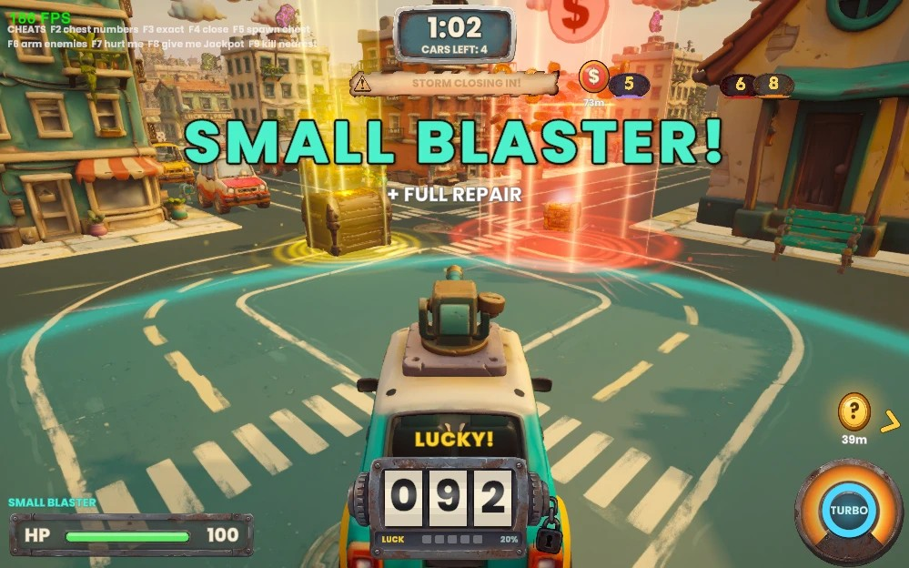
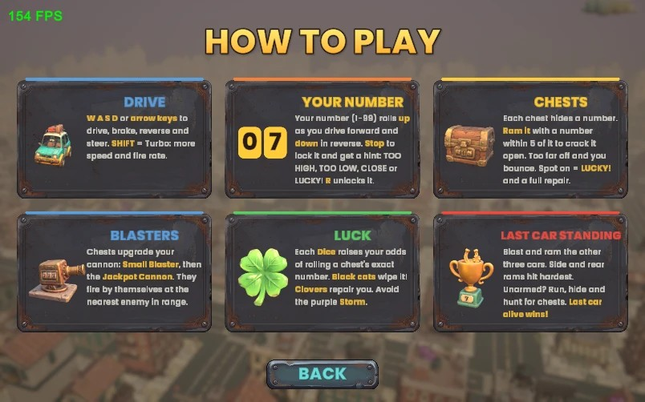
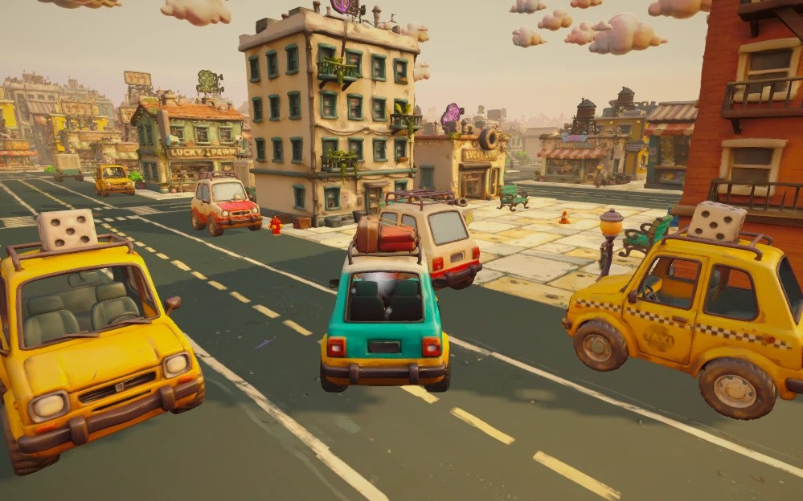

# Jackpot Derby

Play it in your browser: [kingmayhem.itch.io/jackpot-derby](https://kingmayhem.itch.io/jackpot-derby)

<table>
<tr>
<td valign="top" width="55%">

Four cars. One cartoon city.

Every car's number is its **odometer**: it rolls like slot-machine reels as you drive. Chests drop into the
city with a hidden lucky number. Match it, ram the chest, and you win a **blaster** that fires on its own at
anyone who gets close. Meanwhile the **Bad Luck Storm** closes in. **Last car standing wins.**

Made for the **Unity Game Jam 2026**. Theme: **Lucky Number**.

## How the lucky number works
- Your number runs from **1 to 100** and wraps around. Drive **forward** to count **up**, **reverse** to count **down**.
- **Stop** to lock your number. You get a hint against the nearest chest: **TOO HIGH**, **TOO LOW**,
  **CLOSE** (within 5) or **LUCKY!** (exact). "WAY" means you're more than 25 off.
- Your locked number stays locked while you drive to the chest. Press **R** to unlock it and roll again.
- **Ram the chest** while you're close or exact: no blaster → **Small Blaster** → **Jackpot Cannon**.
  Exact numbers also fully repair your car.
- Red **Jackpot chests** repair you even on a close hit.
- But stopping is a gamble: a stopped car is an easy target!

## Luck and superstition
- **Dice** stack luck (up to 5). Each one rolls your number toward the nearest chest's, closer the luckier you are.
- **Black cats** wander the streets. Hit one and your number gets scrambled and your luck wiped.
- **Four-leaf clovers** patch up your car.

## Combat
- Blasters aim and fire **automatically** at the nearest enemy in range. You just drive.
- **Ram** other cars for damage. Hits to the side or rear hurt more.
- Unarmed? Run, hide, or ram.
- Your rivals: **Lucky 8** (aggressive hunter), **Black Cat 13** (sneaky ambusher) and
  **Double Dice 11** (chaotic gambler).

## Controls

| Key | Action |
|---|---|
| W / ↑ | Accelerate |
| S / ↓ | Brake, then reverse |
| A D / ← → | Steer |
| Shift | Turbo (2 s boost to speed and fire rate) |
| R | Unlock your number |
| Esc | Pause (Graphics: Auto / High / Low is in the pause menu) |

Best played on a desktop browser with a keyboard. The first load can take a moment.

</td>
<td valign="top" width="45%">

  
  
  
  
  

</td>
</tr>
</table>

## Running the project in Unity
1. Install **Unity Hub** and **Unity 6000.6.8f1** (Unity 6) with **Web Build Support**.
2. Clone or download this repository.
3. In Unity Hub choose **Add → Add project from disk** and pick the project folder.
   The first open takes a while: Unity imports the models and textures.
4. Open **`Assets/Scenes/Arena.unity`** and press **Play**.
5. To make a browser build: **File → Build Profiles → Web → Build**. The project uses its own
   `JackpotDerby` WebGL template.

The project uses the Universal Render Pipeline (URP), glTFast for the models and AI Navigation for the
rival cars; Unity installs these packages automatically from `Packages/manifest.json`.

## Credits and AI disclosure
I handled all core gameplay and engine programming directly, leveraging modern AI coding assistants selectively to draft test suites, check edge-case coverage, and speed up boilerplate setup. 

Concept images were made with Google Nano Banana and 3D models were made with Tripo AI. 

Sound effects and music were synthesised in the Unity editor for this game.

Font: Poppins by Indian Type Foundry & Jonny Pinhorn, SIL Open Font License 1.1.

Made with Unity 6 (URP).

## License
- **Code** (`Assets/Scripts`, the WebGL template): MIT, see [`LICENSE`](LICENSE).
- **Art, 3D models, textures, music and sound effects**: © 2026 Lefika, all rights reserved,
  see [`ASSETS_LICENSE.md`](ASSETS_LICENSE.md).
- **Poppins** font: SIL Open Font License 1.1 (`Assets/UI/Fonts/OFL.txt`).
