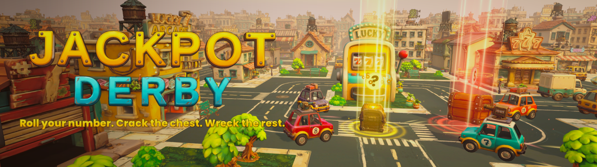
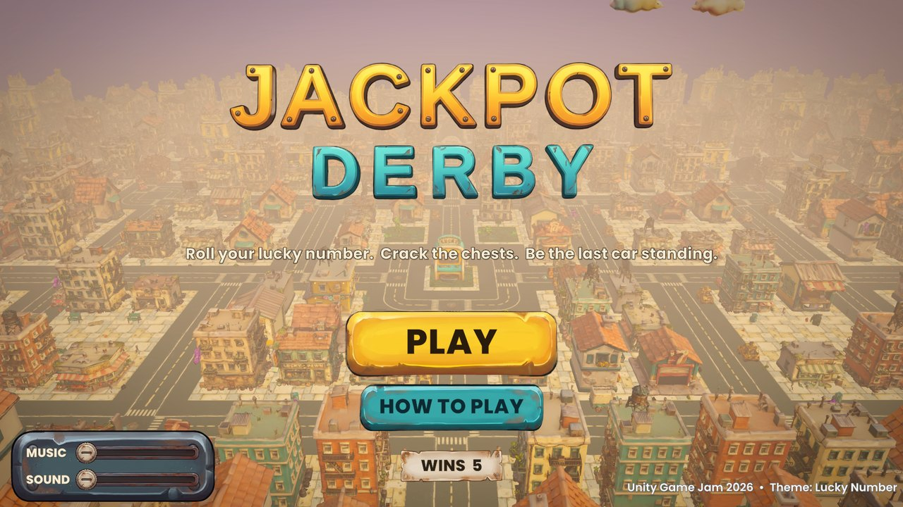
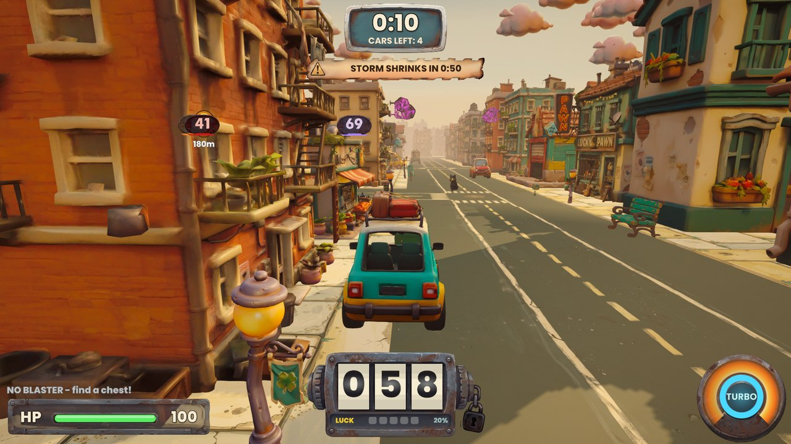
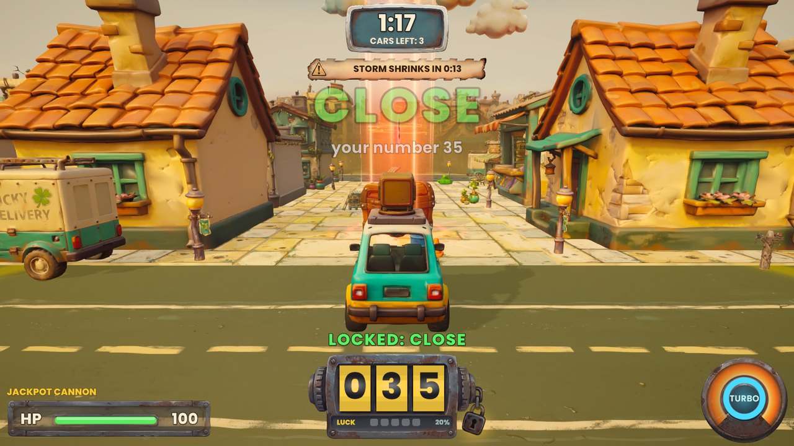
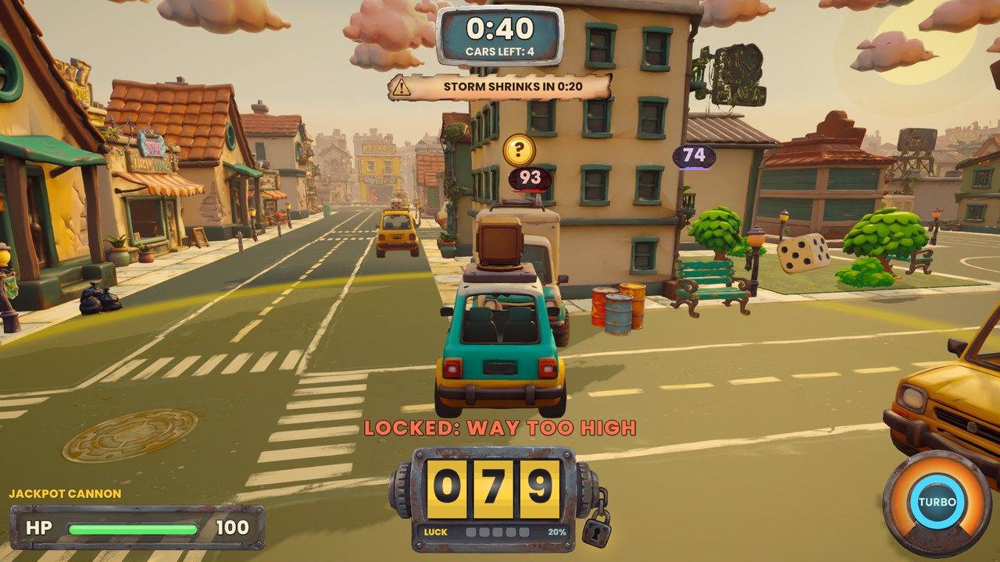
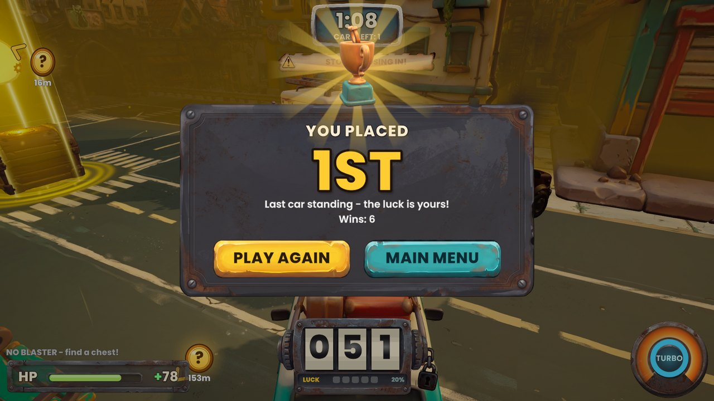

# Jackpot Derby

A lucky-number car brawl made for the **Unity Game Jam 2026** (theme: *Lucky Number*).
Roll your odometer, crack chests, last car standing wins.

Four cars in a cartoon city. Every car's number is its **odometer**, rolling like slot-machine reels as
it drives. Chests drop in with a hidden lucky number: stop to lock your number and get a TOO HIGH /
TOO LOW / CLOSE hint, then ram the chest with a close enough number to win a blaster that fires on
its own. A Bad Luck Storm shrinks the arena. **Last car standing wins.**

## Screenshots

| | |
|---|---|
|  |  |
| **Title screen** | **Your number rolls as you drive** |
|  |  |
| **Stop to lock it: CLOSE to the chest's number** | **Hints steer your guess; dice add luck** |
|  | |
| **Last car standing takes the trophy** | |

## Controls

| Key | Action |
|---|---|
| W / ↑ | Accelerate |
| S / ↓ | Brake, then reverse |
| A D / ← → | Steer |
| Shift | Turbo |
| R | Unlock your number |
| Esc | Pause (Graphics: Auto / High / Low is in the pause menu) |
| F1 | Show the frame rate |

## Opening the project

- Unity **6000.6.8f1** (Unity 6), Universal Render Pipeline, target platform **Web (WebGL)**.
- Open the folder in Unity Hub, then open `Assets/Scenes/Arena.unity` and press Play.
- Gameplay scripts are in `Assets/Scripts`. The arena, scenery prefabs, menus and sounds are generated
  by editor tools under the **Jackpot Derby** menu (see `Assets/Scripts/Editor`).
- `CLAUDE.md` is the full design document.

## Credits and AI disclosure

Code written with Claude (Anthropic). Concept images made with Google Nano Banana. 3D models made with
Tripo AI. Game design, direction and asset selection by Lefika.
Sound effects and music were synthesised in the Unity editor for this game.
Font: Poppins by Indian Type Foundry & Jonny Pinhorn (SIL Open Font License 1.1).

## License

Code: MIT (`LICENSE`). Art, models, music and sounds: all rights reserved (`ASSETS_LICENSE.md`).
